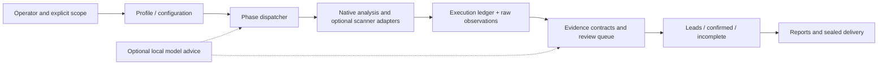

# TBHM — The Bug Hunter Master

**Release:** 4.2.7 · **Type:** Security assessment orchestration framework · **Primary stack:** Python 3.12 with optional Go executor and local AI · **Status:** Source release with documented limitations; not a claim of comprehensive scanner or model validation.

> **Use only on assets you own or are explicitly authorized to assess.** TBHM is not an autonomous proof of exploitability. A phase being available does not imply its external dependencies are installed, it ran successfully, or its outputs represent confirmed findings.

TBHM brings together web/API, source, mobile, enterprise, firmware, and reverse-engineering assessment *phases* in an installable Linux distribution. It focuses on execution accountability, conservative interpretation of scanner output, reproducible evidence, and separating **leads** from **verified findings**. Optional local-model features can advise or prioritize; they do not independently confirm vulnerabilities.

## At a glance

| Dimension | In this release | What it does **not** establish |
| --- | --- | --- |
| Orchestration | 145 dispatchable phase names verified in the publication clone | 145 independently tested live scanners |
| Environment | Linux x86-64, glibc 2.27+, Python 3.12; hash-locked offline wheels | Universal OS, architecture, or Python support |
| Web/API | Authorized profile, request policy controls, per-adapter execution ledger | Global containment of every child process/browser |
| Source | Offline code analysis, native SBOM, external adapters where available | Executing untrusted projects safely or full SAST coverage |
| Verification | Proof-v2 contracts for selected finding classes; controls and repeat captures | AI/scanner prose or HTTP status code as vulnerability proof |
| Reporting | Review queue, HTML/Markdown reports, delivery snapshots and hashes | Independent digital attestation or a zero-risk target |
| Local AI | Optional Ollama/model guidance and bounded dispatcher scheduling | Validated real-model reasoning, training, or complete retrieval |

## Quick navigation

- **[Start here: documentation hub](docs/portfolio/INDEX.md)** — reading paths for recruiters, practitioners, maintainers
- **[ابدأ هنا بالعربي](docs/portfolio/START_HERE_AR.md)** — Arabic guided tour
- **[Architecture explained](docs/portfolio/ARCHITECTURE_WALKTHROUGH.md)** — stage-by-stage data flow and trust boundaries
- **[Component / folder map](docs/portfolio/MODULE_MAP.md)** — where to find implementations and documentation
- **[Practical operator playbook](docs/portfolio/WORKFLOWS.md)** — offline source example, authorized web workflow, result interpretation
- **[Evidence and finding verification](docs/portfolio/PROOF_AND_FINDINGS.md)** — what makes a finding confirmed
- **[AI: supported roles and limits](docs/portfolio/LOCAL_AI.md)** — what optional local inference can and cannot do
- **[Tests and release evidence](docs/portfolio/TESTING_AND_VALIDATION.md)** — reproducible verification commands, evidence classifications
- **[CI foundation and limits](docs/portfolio/CI_GUIDE.md)** — offline release gate, manual regression and interpretation
- **[Security / scope boundaries](docs/portfolio/SECURITY_BOUNDARIES.md)** — enforced core behavior and limitations
- **[Release evolution](docs/portfolio/RELEASE_HISTORY.md)** — capability groups and 4.2.7 changes
- **[Project walkthrough](docs/portfolio/RECRUITER_OVERVIEW.md)**
- **[Planned synthetic demo](docs/portfolio/DEMO_PLAN.md)** — roadmap only, not yet executed — a fast, evidence-grounded portfolio narrative
- **[Publication and GitHub push protection](docs/portfolio/PUBLISHING_AND_PUSH_PROTECTION.md)** — historical blocking events and safety lessons
- **[Known limitations](KNOWN_LIMITATIONS.md)** · **[Third-party notices](THIRD_PARTY_NOTICES.md)** · **[Current project-rights notice](NOTICE.md)**

## Architecture overview



This diagram describes the **logical flow**, not an exhaustive class-level or process-level call graph. The model does not bypass the evidence verifier. For the implementation-level diagram and file-level architecture, consult `docs/review-v4.2.7/ARCHITECTURE.md` and `docs/review-v4.2.7/FILE_MAP.md` included in the distribution.

## Installation (Kali / compatible Linux)

The tested runtime is **Python 3.12.14**, not the latest system Python by default. From a complete, verified TBHM 4.2.7 release checkout:

```bash
bash install.sh --offline --python /path/to/python3.12
./tbhm --version
./tbhm --help
.venv/bin/python scripts/validate_v4_release.py
```

Use the correct Python 3.12 executable for your environment. The offline installer consumes the bundled hash-locked dependency wheels and validates the release manifest. Consult [installation notes](docs/UPGRADE-v4.2.7.md) before customizing an operator machine. Optional external scanners, browsers and models are managed separately.

## Two workflows you can reproduce

### 1) Offline source assessment (does not require a live target)

```bash
./tbhm --code-dir /path/to/your/local/project --offline \
  --phases code_scan,code_intel,report,evidence_finalize \
  --no-ai-observe -o /path/to/private/results -y
```

This is local source analysis. Run it on a project you may legally inspect. `--offline` blocks network-dependent native operations and non-offline adapters according to their declared contracts; do not interpret it as a general sandbox for untrusted source or binaries.

### 2) Authorized web assessment (network traffic)

```bash
./tbhm -u https://authorized.example.com --profile authorized_safe \
  --rate-limit 2 --no-bootstrap -o /path/to/private/results -y
```

**Replace the illustrative URL with an explicitly approved scope.** An authorized profile and rate limit are **not** a substitute for a real signed scope and host policy. Child-process scanner traffic has separate controls and is not all represented in the Python request counter. Read the [operator workflows](docs/portfolio/WORKFLOWS.md) and [boundaries](docs/portfolio/SECURITY_BOUNDARIES.md) first.

## Understand the outputs

| Artifact | Why it matters |
| --- | --- |
| `execution_ledger.json` | What was attempted, blocked, skipped, failed or incomplete |
| `REPORT_final.html` / `REPORT_final.md` | Human-readable assessment output |
| `REPORT_confirmed.md` | Findings accepted by the current verifier, for supported contracts |
| `REPORT_leads.md` | Leads needing manual follow-up; not proven vulnerabilities |
| `OPERATOR.html` | Local operator review interface |
| `evidence_manifest.json` | References the final sealed delivery snapshot |
| `delivery/run-.../` | Redacted delivery, backup and hash inventory; do not expose working secrets |

Review each output *together* with coverage gaps. A report with no confirmed findings is **not** automatically a clean bill of health.

## Validation and what the evidence proves

The publication-preparation review records a successful local fresh-clone offline install, compile/import checks, and resolution of **145 phase names**. Its full regression groups were reported as passed for that reviewed build. These are **package and regression checks**, not proof of successful live target scans, browser containment, or AI inference correctness. See [test evidence](docs/portfolio/TESTING_AND_VALIDATION.md) and the release review materials.

```bash
.venv/bin/python scripts/run_tests.py --source . --workers 1 \
  --output "$HOME/tbhm-work/publication/full-regression-v427.json"
```

Keep test output outside the repository. The review's evidence applies to its checked source build, and must not be represented as a fresh run on a modified checkout.

## Ownership, provenance, and licensing

TBHM contains inherited functionality and successive improvements. Contribution claims should identify who built, tested, or maintained each part, with traceable commit and test evidence; **do not infer authorship from repository ownership**. See [contribution claims](docs/portfolio/CONTRIBUTION_CLAIMS.md).

The 4.2.7 publication kit records that original project source has **no chosen project-level license**. A public GitHub repository does not automatically grant reuse rights. The source-rights holder must choose a valid license; third-party notices stay in force. No license has been added by this documentation pack.

## Public repository and CI status

The `main` branch of [msemno/TBHM](https://github.com/msemno/TBHM) was successfully pushed and confirmed public on 3 November 2026, with release source commit `6d1f2bd` and portfolio documentation commit `eafe694`. The initial push was blocked by GitHub Push Protection for Stripe-shaped literals in regression fixtures; see the [publication history](docs/portfolio/PUBLISHING_AND_PUSH_PROTECTION.md). **Accepted publication does not prove a comprehensive credential or privacy review.**

This CI foundation adds a GitHub Actions workflow for Python 3.12 offline installation and release/manifest validation. **Its success is not claimed until a real GitHub Actions run reports success.** Full regression remains a manual opt-in; no external targets, real-model performance or automated scanning coverage is implied. See the [CI guide](docs/portfolio/CI_GUIDE.md).
