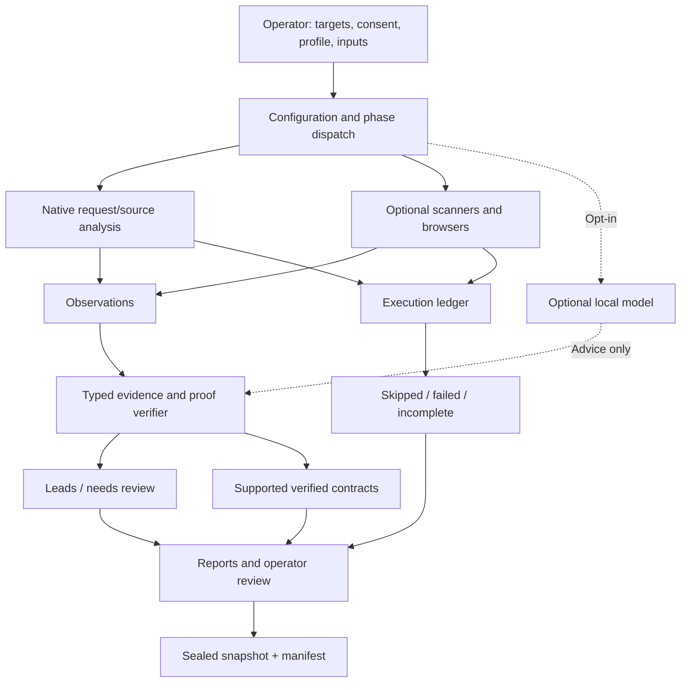

# Architecture walkthrough — from scope to report

This is a **logical explanation** of the current 4.2.7 orchestration design, based on the supplied operator and release documentation. For class- and file-level identities, inspect the included 4.2.7 architecture and file map before making code changes.

## 1. Configuration and authority

The operator chooses the target, profile, phase selection, credentials when authorized, time/rate budgets, and local inputs. The Python Requests path enforces target/policy checks, TLS verification, redirect decisions and bounded response handling. Network-scanning phases need more specific IP/CIDR authority than a hostname association. A *configured* scope still requires an actual external authorization basis.

## 2. Phase dispatch

The release validation establishes that 145 registered phase names resolve to modules exposing `run()`; it does not independently exercise all external tools. The 4.2.7 dispatcher can accept opt-in, bounded model-based phase priority choices. Explicit model selection should be retained rather than silently overridden.

## 3. Native detection vs optional tools

Native checks, source inventories, passive artifacts (OpenAPI/HAR) and optional subprocess scanners each have different applicability and observability. External adapter controls **do not** constitute a universal sandbox. A failed subprocess, missing scanner, parser error or timeout is an incomplete assessment branch, not a negative result.

## 4. Evidence, review and proof authority

Observations first enter an evidence/review pipeline. For *supported proof contracts*, confirmation requires bound local captures, matching target/identity/request details, a negative control and independent repeat captures. Other findings remain leads even when a scanner calls them critical. The optional AI path provides counterevidence suggestions or scheduling hints—not proof of exploitability.

## 5. Reporting and immutable-looking delivery

Reports identify accepted findings, leads and incomplete execution. The delivery snapshot includes redaction checks, hashes and a consistent state backup. Snapshots are not an independently signed attestation. Runtime working directories may hold sensitive capture state and should stay private.

## Key trust boundaries

| Boundary | Enforced / documented | Do not assume |
| --- | --- | --- |
| Python HTTP requests | Target/policy checks, bounded size, TLS and redirects | Global accounting of all subprocess traffic |
| Scanner subprocess | Adapter-level invocation/diagnostics | Absolute process/network isolation |
| AI model | Advisory interpretation; optional scheduler | Authorization, confirmation or trained competence |
| Evidence → confirmed | Contract-specific verifier and controls | Scanner confidence or repeated status codes alone |
| Local working state → delivery | Redaction, snapshot and file hashes | Publicly safe raw state or third-party signature |

## More precise references

- `docs/review-v4.2.7/ARCHITECTURE.md`: implementation overview supplied with the release.
- `docs/review-v4.2.7/FILE_MAP.md`: file-level map supplied with the release.
- `docs/PROOF-v2.md`: proof contract design and required captures.
- [Limitations](../../KNOWN_LIMITATIONS.md): gaps that an architectural diagram cannot imply away.
