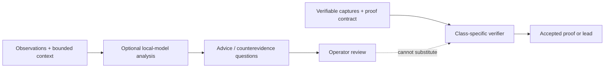

# Local AI integration — utility without proof inflation

TBHM supports optional locally hosted model functions. This page is intentionally conservative: the supplied preparation evidence did **not** independently benchmark a selected real model, validate training, or establish retrieval-index completeness.

## Where an AI model fits

The 4.2.7 release also supports **opt-in bounded scheduling choices** inside dispatcher windows. That is an operational prioritization aid, not permission to invent new targets, expand scope, suppress a finding or bypass an evidence check.

## Distinguish five separate checks

1. **Endpoint connectivity:** a service like Ollama responds.
2. **Generation capability:** the chosen model actually returns a response in time.
3. **Hardware placement:** inference executes where expected; a responsive loopback endpoint alone does not establish GPU placement.
4. **Retrieval readiness:** embeddings exist and the intended index coverage has been checked.
5. **Reasoning quality:** independently labeled, held-out security cases demonstrate accuracy and calibration.

One passing check never implies the next. Empty indexes, pending embeddings and unreachable model endpoints must remain visible to the operator rather than being silently marked complete.

## Questions for future evaluation

- Does the chosen model distinguish attacker-controlled vs trusted input?
- Can it point to exact source/evidence IDs without fabricating them?
- Does it suggest a negative control before stating a vulnerability is verified?
- Can it abstain when the request budget, target binding or log context is missing?
- What is its per-case latency and false-positive rate on held-out cases?

**Status:** evaluation goals, not completed benchmark results. See [known limitations](../../KNOWN_LIMITATIONS.md) and the 4.2.7 engineering review.
