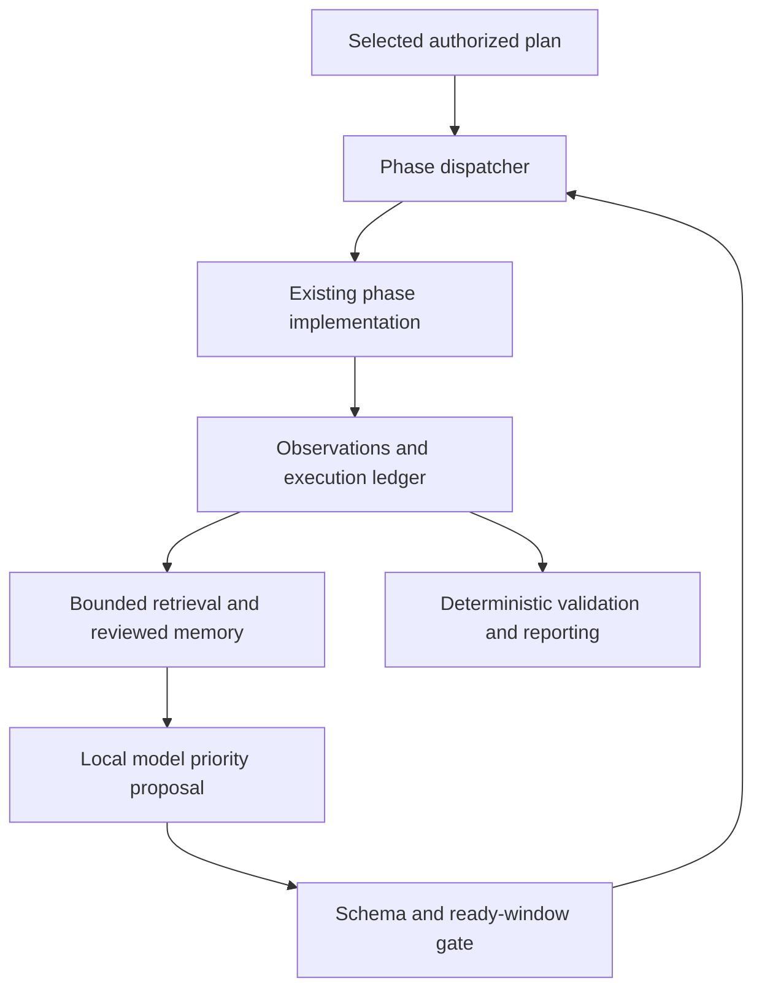

# How TBHM 4.2.7 executes and where the model participates

## Execution and evidence

`tbhm.py` parses arguments, chooses a profile/intensity, loads scope and program policy, prepares a run context and storage, activates the native request guard, and dispatches phase modules. The existing phase identities and CLI forms remain. The observer records structured events, sanitized run artifacts, candidates and bounded vector updates. Reporting separates evidence states; finalization seals a delivery snapshot.

The model receives a redacted partial snapshot: recent phase outcomes, finding count and up to three evidence excerpts, plus bounded source/public retrieval. Eligible reviewed scenarios can be retrieved within the explicitly permitted project. It chooses one phase ID and records a short reason, evidence references and review notes. This is an operational decision inside the main loop; the result can change the very next dispatched phase.

The dispatcher enforces the selected-phase membership and independent-window rules. All selected phases remain pending until dispatched; the model has no skip/add/command/proof API. Preflight, producers, unknown phases, correlations, strict proof, reporting and sealing are barriers. Existing phase and request policies still run after scheduling.

| Ready window | Why its members can be prioritized | Boundary |
| --- | --- | --- |
| `spec_scan`, `api_fuzz` | Both can consume the already selected live targets and existing recon inputs | Do not move either across a correlation/producer barrier |
| `auth_modern_review`, `api_specific`, `graphql_audit`, `interface_probe` | Independent interface/auth review consumers of prior collected surface | Their usual input, active-profile and request constraints remain |
| `code_security_tooling`, `supply_chain_review`, `ci_cd_supply_chain_security` | Read-only source/CI/dependency checks over supplied source/import inputs | Tool installation/build/workflow execution is not granted |

Only a contiguous window beginning at the next pending phase is eligible. The window is at most six entries. There are three decision requests by default, at most eight explicitly; two decision failures stop further scheduling requests. A generation call is capped at the configured timeout or 60 seconds, whichever is lower. Retrieval requests have their own existing bounds. Invalid/missing fields, invented evidence IDs, an unselected phase or a model outage retain the deterministic order.

The operator can disable runtime prioritization simply by retaining the default `--ai-control observe`. This preserves existing scripts. `--ai-apply-plan` retains its older contract: apply an already approved next-step proposal at run start. It is distinct from the new intra-run scheduler.

## Core ownership map

| File / area | Responsibility | Modification rule |
| --- | --- | --- |
| `tbhm.py` | Argument contracts, selected phases, run lifecycle, dispatcher, resume compatibility | Keep phase identities, policy gates and finalization order |
| `profiles/`, `core/intensity.py` | Authorized capabilities and work intensity | Intensity never enlarges authorization |
| `core/targets.py`, `core/scope.py`, `core/program_policy.py` | Asset identities, allow/exclude matching, program restrictions | Exclusions win; evidence does not expand scope |
| `core/http_policy.py`, `core/request_guard.py` | Native request budgets, method/scope checks, lifecycle, cooldowns, finite buffering | Service traffic stays separate from target budgets/proxies |
| Runner and external execution boundary | Child ownership, process I/O, argument-vector execution, adapter restrictions | Native Requests hooks do not prove subprocess containment |
| `core/storage.py` | Run DB, findings, observations, candidates, test executions and redaction | Persist evidence/IDs; do not promote from imported labels |
| `core/finding_class.py`, strict validators and confirmation receipts | Deterministic authority for a confirmed finding | Never accept LLM confidence, a status code or a narrative as proof |
| `core/scanner_normalizer.py` | Result-format parsing and import provenance | Parse actual result records, not arbitrary metadata or error trees |
| `phases/protected_routes.py` | Anonymous route inventory and sensitive-field leads | Public pages and static assets do not establish an auth defect |
| `core/code_patterns.py`, taint/code-intel modules | Source inventory, static signals, limited dataflow | Separate declaration/feature presence from executable vulnerable flow |
| `phases/supply_chain_review.py` | Static package-source/integrity review | Resolve bounded in-tree links before confusion claims |
| `phases/ports.py` | Explicitly authorized IP port discovery/service review | DNS relationships and default HTTP scope do not authorize shared IP scans |
| `phases/mobile_scan.py` | Static APK/IPA/source analysis and input receipts | Artifact type and version are required; static does not imply dynamic |
| `core/ai_plane/runtime_control.py` | Opt-in runtime phase priority and durable decision receipts | Typed selected-phase choices only; no command execution or policy authority |
| `core/ai_plane/observer.py` | Structured lifecycle learning and end-of-run advisories | Failure must remain visible and must not stall indefinitely |
| `core/ai_plane/advisor.py`, `core/llm_local.py`, `core/llm_review.py` | Bounded local inference, RAG, schemas and grounded counterevidence advice | Verify citations/source quotes independently; advice cannot suppress proof |
| `core/ai_plane/scenarios.py` | Pending/quarantined/reviewed cases, project/reuse governance | Reviewed validity and actual reuse rights precede retrieval/training export |
| Self-evaluation/improvement/job modules | Frozen evaluations, comparison, promotion, rollback and single-worker jobs | Training and promotion remain optional and explicitly gated |
| `core/operator_view.py`, reporter, evidence manifest | Review queue, exports, actual execution vs test coverage, sealed delivery | Report generation does not mean every selected test succeeded |
| `install.sh`, pinned wheels/lock, package verifier | Offline core environment and exact package integrity | No automatic all-tools install or unrequested privilege escalation |

`FILE_MAP.md` indexes every Python module in core/phases/scripts by actual module docstring and definitions. It is an inventory, not a claim of line-by-line formal verification. The unified patch is the exact line-level record of this release's edits.

## Persistent memory and learning

The portable AI home stays outside the source directory. `database/memory.sqlite3` is authoritative for source documents/chunks, runs, proposals and scenario state. The vector matrix is a homogeneous rebuildable cache. A source update needs a delta sync; a runtime run is allowed to store a bounded backlog without embedding every artifact synchronously.

The public CVE/CWE catalog is a separate SQLite/FTS5 reference corpus. It provides context, affected-product descriptions, root-cause vocabulary and references. Presence of a CVE, CWE, example or exploit title is not evidence the current asset is affected. Rejected/deprecated records retain their state. Imported reference data and embeddings do not alter the model's weights.

A reviewed eligible scenario can contribute prior mistakes, missing controls, verified outcomes and limitations. The new controller requires explicit project reuse permission for this path and uses the existing scenario API; it does not read unscoped private case text directly from legacy tables. Pending, quarantined and held-out cases must not leak into runtime lesson retrieval.

A useful improvement loop is: collect an observation → preserve exact evidence → independently validate or refute with controls → review the case with provenance → evaluate on frozen separate cases → approve an improvement if measured → monitor regression → roll back if necessary. Model-written labels are not independent validation. Fine-tuning is a separate optional future job and is not a scanner runtime dependency.

## Model prompts and changes

The runtime scheduling system prompt is `SYSTEM` in `core/ai_plane/runtime_control.py`. The window definitions and validator beside it enforce what the scheduler may accept. Modify a prompt through a normal source change and evaluate it; do not edit the model-lock or schema to make a failed evaluation look successful. The existing advisory prompt lives in `core/ai_plane/advisor.py`; finding-review prompts and source-quote checks live in the LLM review/client modules.

A prompt change can improve explanations or prioritization, but text instructions cannot replace authorization and proof checks. Preserve the four-field runtime response (`next_phase`, `reason`, `evidence_ids`, `review_notes`), current request limits, data fencing and deterministic membership gate. Explain any change in terms of a measured failure and a held-out evaluation rather than an assertion that the model now understands every vulnerability.

## Remaining engineering work

1. Replace broad string-based inventory interfaces with typed assets/observations across all adapters; the mobile hint producer and new route review are scoped improvements.
2. Expand independently tested ready-window metadata into a real producer/consumer graph before permitting cross-window scheduling or new phase selection.
3. Add typed per-target technology/operation applicability and measured marginal coverage so a JSON-RPC endpoint does not inherit a browser methodology by default.
4. Prove scope/rate/header/redirect enforcement for each external scanner and browser adapter, or retain an explicit block. Do not set universal containment flags from a native Requests test.
5. Expand vulnerability-specific proof classes, multi-actor ownership/tenant controls, attributable OAST and requirement-level standards coverage with controlled executable cases.
6. Add effective background maintenance with explicit budgets and durable checkpoints; do not make online scanning rebuild the whole corpus or spawn unconstrained training workers.
7. Commission a frozen independently labeled evaluation using different repositories/version families. Include adversarial evidence, public resources, benign tests, privileged CI paths and real unsafe workflows. This release's fixtures verify mechanics; they do not close this quality gate.

Research basis: [Ollama structured outputs](https://docs.ollama.com/capabilities/structured-outputs), [Ollama generation API](https://docs.ollama.com/api/generate), and [OWASP excessive agency](https://genai.owasp.org/llmrisk/llm062025-excessive-agency/). These sources support schema validation and limiting model authority; the particular phase-window design is this release's engineering choice, tested locally. Retrieved 2026-10-29 UTC.
